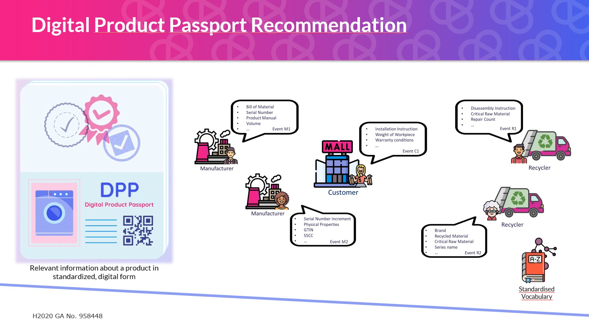

# Digital Product Memory Information Linking and Storage Service

## About

This repository accompanies a paper submitted to the *Journal of Circular Economy*.

This is a prototype for a decentralized Digital Product Passport (DPP) system. It was developed as the Digital Product Memory Information Linking and Storage Service in the EU H2020 project CircThread, Deliverable D4.2: https://circthread.com/.

The service combines product lifecycle data from registered data providers and filters/recommends that data for a selected stakeholder role, lifecycle event, or both.

The goal is not to show every available product field to every user. Instead, it resolves a digital product passport dynamically and shows the information that is relevant for the current context, for example recycling, repair, resale, purchase, or disposal.

## What the Project Does

The project models a circular-economy data ecosystem:

1. A user searches for a product by product ID, EPREL model identifier, or by scanning a QR code, NFC tag, or RFID tag in the frontend.
2. The Resolver asks the Recommendation Engine which DPP fields are relevant for the selected role/event context (`POST /recommend/fields`).
3. The Resolver asks the Service Registry which providers can contribute these fields for this product (`POST /services/select`).
4. Only the selected providers are queried, in parallel; their JSON fragments are merged with source attribution and conflict detection.
5. The Recommendation Engine filters the aggregated data; the response contains a role- and event-specific Digital Product Passport with prioritized fields, the data gaps, separate suggestions of the extended algorithms, and the provider selection.

Example: A recycler looking up a lithium battery during recycling sees hazardous substances, material composition, disassembly instructions, and recycling guidance. A consumer looking at the same product during purchase sees energy, warranty, price, lifetime, and repairability information.



## Architecture

Local development exposes the frontend and backend service ports directly so each API can be inspected in a browser.

```text
Frontend :3000
    |
    v
Resolver :8001
    |
    +--> Service Registry :8003
    |       Finds active data providers
    |
    +--> Mock Provider :8010
    |       Provides prototype product data
    |
    +--> Recycling EOL Provider :8021
    |       Provides recycling and end-of-life data
    |
    +--> Midlife Purchase Provider :8022
    |       Provides purchase and use-phase data
    |
    +--> AAS Digital Nameplate Provider :8023
    |       Reads AAS Digital Nameplate input
    |
    +--> EU EPREL Provider :8024
    |       Maps public EU energy label registry records
    |
    +--> Repair & Service Network Provider :8025
    |       Provides repair, fault, service-contract, and refurbishment records
    |
    +--> Recommendation Engine :8002
            |
            v
        Neo4j :7474 / :7687
        Stores role, event, product type, and data-field relationships
```

Production deployment uses Caddy as the only public entrypoint:

```text
Internet
    |
    v
Caddy :80 / :443
    |
    v
Frontend / Nginx :80
    |
    +--> /api/resolver/*        -> Resolver :8001
    +--> /api/recommendation/*  -> Recommendation Engine :8002
    +--> /api/products          -> Mock Provider :8010

Internal Docker network only:
Resolver, Service Registry, Recommendation Engine, Providers, Neo4j
```

## Request Processing Pipeline

The Resolver (`services/resolver/app/resolver_logic.py`) processes `GET /resolve/{product_id}?role=&event=` as follows:

1. **Product type** – taken from the request or looked up in the cached provider catalogue (`GET /products` of all providers, cache TTL 60 s).
2. **Recommendation plan** – `POST /recommend/fields` returns the core recommendation for role, event, and product type (static Knowledge Graph plus context-matching dynamic templates).
3. **Provider selection** – `POST /services/select` on the Service Registry. A provider is selected if
   - it supports the product type (if it declares product types),
   - it knows the identifier: providers with a closed catalogue (`product_ids`) must list it; providers with an open catalogue (e.g. EPREL) must match their `conditions.identifier_pattern`, or are used if no closed catalogue knows the identifier,
   - it can contribute at least one recommended field (`data_fields`) or, if it declares no fields, at least one recommended data category (`data_categories`). Identity fields and the categories `identification` and `metadata` do not justify a query.
   Skipped providers are returned together with the reason.
4. **Parallel retrieval** – the selected providers are queried concurrently (`asyncio.gather`). If a provider returns the product under another identifier (e.g. the EPREL provider resolves the model identifier `SN43HW04ME` to the registration number `2613426`), the providers that know the resolved identifier are queried as well; `provider_selection.resolved_identifier` reports it.
5. **Aggregation** – fragments are merged in registry order; internal fields (`_…`) are ignored, empty values never overwrite non-empty ones, every provider of a value is recorded in `_field_sources`, and differing non-empty values are reported in `conflicts` (the value of the provider listed last in the registry is kept).
6. **Filtering** – `POST /recommend` builds the role- and event-specific view.

The response contains `provider_selection` (`queried`, `responded`, `excluded` with reasons, `provider_requests_ms`) and `conflicts`. Without role and event (generic view), for the raw view (`/resolve/{id}/raw`), and if the Recommendation Engine is unavailable, all providers that know the product are queried.

Data categories are a shared vocabulary (`shared/models.py: DataCategory`, `shared/vocabulary.py: FIELD_CATEGORIES`) used identically by the Knowledge Graph, the Service Registry and the providers. Legacy category names (`specifications`, `energy_label`, `hazardous_substances`) are normalised on registration.

## Services

| Service | Port | Purpose |
| --- | --- | --- |
| Caddy | 80 / 443 | Production HTTPS reverse proxy with automatic Let's Encrypt certificates |
| Frontend | 3000 | React UI for passport lookup, provider registry inspection, DPP Builder, and SSSOM mappings |
| Resolver | 8001 | Main API used by the frontend; orchestrates discovery, aggregation, and filtering |
| Recommendation Engine | 8002 | Uses Neo4j mappings to decide which fields are relevant |
| Service Registry | 8003 | Stores available data provider endpoints |
| Mock Provider | 8010 | Provides base product data (identification, technical data, etc.); fields held by the specialised providers are delegated to them |
| Recycling EOL Provider | 8021 | Provides recycling and end-of-life data for selected products |
| Midlife Purchase Provider | 8022 | Provides purchase and use-phase data for selected products |
| AAS Digital Nameplate Provider | 8023 | Reads an Asset Administration Shell Digital Nameplate and maps it to passport fields |
| EU EPREL Provider | 8024 | Maps public EU EPREL product registry records to passport fields and resolves EPREL model identifiers such as `SN43HW04ME` |
| Repair & Service Network Provider | 8025 | Provides repair records, fault codes, service intervals and contracts, spare-part sourcing, and refurbishment grades |
| Neo4j | 7474 / 7687 | Graph database for the recommendation ontology; populated from the bundled graph snapshot on first start |

## Core Concepts

### Product Passport

A product passport is represented as structured JSON. The shared schema is defined in `shared/models.py` and includes:

- identification data such as product ID, manufacturer, model, and serial number
- technical specifications
- components and material composition
- sustainability metrics such as repairability, recyclability, and carbon footprint
- safety and compliance information
- end-of-life instructions
- economic and maintenance data

### Roles

The prototype currently supports these stakeholder roles:

| Role | Typical focus |
| --- | --- |
| `consumer` | purchase information, repairability, warranty, energy label |
| `recycler` | material composition, hazardous substances, disassembly, recycling |
| `manufacturer` | full technical and compliance context |
| `repairer` | components, specifications, repair history, disassembly |
| `collector` | disposal, residual value, hazardous substances, logistics-relevant fields |

The selected role answers the question: who is asking for the product passport? It changes the recommendation because a recycler, consumer, repairer, manufacturer, and collector need different information from the same product data.

### Lifecycle Events

Supported lifecycle events are:

- `purchase`
- `repair`
- `recycling`
- `maintenance`
- `disposal`
- `resale`

The selected lifecycle event answers the question: in which situation is the product passport used? A purchase view prioritizes different fields than repair, resale, disposal, or recycling.

The primary recommendation mode is `role + event`, for example `consumer + purchase` or `recycler + recycling`. The UI also supports broader modes:

| Selected filters | Mode | Behavior |
| --- | --- | --- |
| Role and event | `role_event` | Uses the exact role/event mapping. This is the default and most precise mode. |
| Role only | `role` | Aggregates all events for the selected role and keeps the highest priority per field. |
| Event only | `event` | Aggregates all roles for the selected lifecycle event and keeps the highest priority per field. |
| Neither role nor event | `generic` | Shows the generic fields supported by the product type. |

In the frontend, choose `Any role` or `Any event` to use the broader modes.

### Custom DPP Templates

The UI also contains a `DPP Builder`. It lets a user create a custom Digital Product Passport by selecting terms from the Digital Product Memory vocabulary.

The process is:

1. Select vocabulary terms.
2. Optionally select a product for a value preview.
3. Save the DPP template.
4. If a product was selected, the Resolver searches all registered providers for the selected data points and returns the available values.
5. The selected terms are stored as a DPP template in Neo4j.

Only terms are stored in Neo4j. Provider values are not stored in Neo4j; they are resolved live through the Resolver.

The template itself is product-independent. A product is only needed when the user wants to preview the actual values that are currently available for the selected terms.

Stored custom templates are shown in the Builder view. They can be loaded for editing, updated with a new term selection, or deleted from the dynamic Neo4j graph.

**Self-defined contexts.** Besides a predefined role and lifecycle event, a template can carry a self-defined event name (`custom_event`, e.g. `Inverter inspection`) and a lifecycle phase (`lifecycle_phase`: `beginning_of_life`, `middle_of_life`, `end_of_life`; see `GET /ontology/lifecycle-phases`). If a predefined event is selected, the phase follows from that event (`purchase` → beginning of life; `maintenance`, `repair`, `resale` → middle of life; `recycling`, `disposal` → end of life) and a contradicting phase is rejected with HTTP 400. A template without a predefined event but with a phase counts as a dynamic recommendation signal for every event of that phase.

**Pseudonymous template users.** The frontend creates a random identifier per browser and sends it as `user_id`. The Recommendation Engine never stores this identifier: `TemplateUser.user_id` holds a salted SHA-256 hash of it (`u-…`, salt configurable via `TEMPLATE_USER_SALT`). Requests without `user_id` are stored as `anonymous`. Users without remaining templates are removed when a template is deleted.

**Partial updates.** `PUT /templates/{template_id}` only changes the context properties that are sent; properties that are omitted (e.g. `product_type`) keep their stored value, and an explicit `null` clears a property.

### Complete Passport View

The frontend also offers an `All data` view for each product. This view calls the Resolver raw endpoint and displays all aggregated provider data for the product without role/event filtering and without Knowledge Graph recommendations.

Use this when you want to inspect the complete Digital Product Passport data currently available from registered providers.

### Recommendation Logic

The Recommendation Engine is graph/rule based. It is not a machine-learning model.

On startup it seeds Neo4j with:

- roles (5: `consumer`, `recycler`, `manufacturer`, `repairer`, `collector`)
- lifecycle events (6: `purchase`, `repair`, `recycling`, `maintenance`, `disposal`, `resale`)
- product types (5: `washing_machine`, `dishwasher`, `boiler`, `solar_panel`, `lithium_battery`)
- data categories (22 categories covering identification, technical, materials, sustainability, safety, compliance, end-of-life, economic, maintenance, metadata, water consumption, performance, connectivity, thermal & combustion, photovoltaic properties, electrical characteristics, battery health, circular economy, supply chain, logistics, and service & ownership)
- data fields (297 fields distributed across the 22 categories)
- weighted `NEEDS` relationships between roles and data fields for specific events (329 relationships covering 15 role–event combinations)
- SSSOM mappings from `services/recommendation_engine/ontology/sssom_mappings.tsv`

The role–event priorities are maintained in a CSV file so that they can be reviewed and adapted without code changes:

```text
services/recommendation_engine/ontology/role_event_priorities.csv   (role, event, field_name, priority)
```

Data fields and product-type assignments are defined in `services/recommendation_engine/app/seed_data.py`; the field-to-category assignment is shared with the other services via `shared/vocabulary.py` (consistency is checked by `services/recommendation_engine/tests/test_vocabulary_consistency.py`).

Re-seeding (`POST /seed`) only replaces the static subgraph; user-created DPP templates (dynamic subgraph) are preserved. An updated SSSOM file (new `mapping_set_version`) is re-seeded automatically on start-up.

**Core recommendation and fallback.** For a role and event, the engine returns the fields of the matching `NEEDS` relationships (`recommendation_source: role_event`) plus fields promoted from context-matching DPP templates (`dynamic_template`), sorted by priority. If no `NEEDS` relationship is modelled for the requested combination, the role-only aggregation is used (`filter_mode: role_fallback`, `recommendation_source: role`). The role- and event-specific view (`recommended_fields`, `filtered_data`) is built from this core recommendation only. Recommended fields without a value (including empty lists/objects/strings) are listed in `data_gaps`.

The SSSOM mapping set is loaded from:

```text
services/recommendation_engine/ontology/sssom_mappings.tsv
```

Those SSSOM rows are stored in Neo4j as `MappingSet`, `SSSOMMapping`, and `OntologyTerm` nodes. Known Digital Product Memory terms are linked back to local `DataField` or `ProductType` nodes with `REPRESENTS_TERM`, so API responses and the frontend can expose external matches such as Schema.org, HS 2022, or ESPR terms.

The mapping set (version 1.1.0) contains 28 manually curated mappings to Schema.org, the Harmonized System 2022 (product types), and concepts of the ESPR (Regulation (EU) 2024/1781, prefix `espr:` based on its ELI). ECLASS mappings are not included because the ECLASS classes could not be verified against a licensed ECLASS release; they can be added as soon as the corresponding IRDIs are available. The ontology `dpp_ontology.ttl` aligns stakeholders and lifecycle events with the Ontology Design Patterns *AgentRole* and *Participation* (`owl:imports` of the ODP files).

The frontend contains a `SSSOM` view that lists all ontology mappings. It shows the source term, SKOS predicate, target term, confidence, local Digital Product Memory terms, and short explanations for predicates such as `skos:exactMatch`, `skos:closeMatch`, `skos:narrowMatch`, `skos:broadMatch`, and `skos:relatedMatch`. Predicate explanations are also available as hover tooltips.

For example, the pair `recycler + recycling` gives high priority to fields such as `materials`, `hazardous_substances`, `disassembly_instructions`, `recycling_instructions`, `cell_chemistry`, `cathode_material`, `critical_raw_materials`, `rare_earth_elements`, `polymer_types_in_casing`, and `second_life_eligibility`.

#### Extended Recommendation Algorithms

Beyond the static role/event graph and the dynamic template threshold, the engine runs four additional algorithms in every recommendation pass. Their candidates are **not** merged into the role- and event-specific view; they are returned separately in `suggested_fields` (sorted by priority) and shown in the frontend as "further suggestions". Each algorithm contributes fields not already covered by the core recommendation or a preceding algorithm. The `recommendation_source` field identifies which algorithm produced a suggestion.

| Algorithm | `recommendation_source` | Signal | Priority range |
| --- | --- | --- | --- |
| Association rule learning | `association_rule` | Co-occurrence of fields in the same custom DPP templates. Confidence = P(candidate \| seed present in template). Only candidates with support ≥ 2 templates and confidence ≥ 0.5 are returned. | 0.65 – 0.80 |
| Lifecycle frequency analysis | `lifecycle_frequency` | Cross-role demand ratio per lifecycle phase. Fields required by many distinct roles in the current event receive a higher score. Without an event, frequency is aggregated across all phases. Priority = 0.8 × role share + 0.2 × mean priority. | 0.0 – 1.0 |
| Role-based preferences | `role_preference` | Historical field selections from custom DPP templates created under the current role. Preference score = selection count / total role-specific templates. | 0.55 – 0.80 |
| Contextual similarity matching | `contextual_similarity` | Shared `DataCategory` membership with already-recommended fields. Fields in the same categories as the current recommendation set are added as contextually similar candidates. | 0.55 |

The algorithms run after the core recommendation. Each algorithm receives the core fields as a seed and only adds new suggestions — core recommendations are never changed. Dynamic templates are counted only if their stored context matches the request (a template created for a role or event counts only for that role or event; templates without role or event count for every context); a term becomes a `dynamic_template` recommendation once it occurs in at least two matching templates (priority 0.65 / 0.70 / 0.75 for 2–3 / 4–5 / ≥6 templates).

**Recommendation source values in the API response:**

| `recommendation_source` | Origin |
| --- | --- |
| `role_event` | Static KG: exact role + event NEEDS relationship |
| `role` | Static KG: role-only aggregation across all events (also used as fallback for unmodelled role–event combinations) |
| `event` | Static KG: event-only aggregation across all roles |
| `static_generic` | Static KG: generic product-type fields, no role or event |
| `basic_fallback` | Identification fields returned when no recommendation exists at all |
| `dynamic_template` | Dynamic graph: term crossed the two-template threshold |
| `association_rule` | Association rule learning over DPP template co-occurrences |
| `lifecycle_frequency` | Frequency analysis of cross-role demand in lifecycle phases |
| `role_preference` | Role-based preference from historical template selections |
| `contextual_similarity` | Contextual similarity via shared DataCategory proximity |

## Neo4j Database Schema

The Neo4j database stores the recommendation ontology used by the Recommendation Engine. It does not store full product passports. Product data comes from provider APIs, while Neo4j stores which passport fields are relevant for a role, lifecycle event, and product type.

The graph is seeded on startup by:

```text
services/recommendation_engine/app/seed_data.py
```

### Bundled Graph Snapshot

The repository ships the complete Neo4j database as a portable JSON snapshot, so that a new installation starts with the same knowledge graph, including the DPP templates of the dynamic layer:

```text
services/recommendation_engine/snapshot/graph_snapshot.json
```

The file lists every node (labels and properties) and every relationship, one per line; temporal values such as `created_at` are stored as tagged ISO strings. Unlike a `neo4j-admin database dump`, it does not depend on the Neo4j store version.

On startup the Recommendation Engine (`initialise_graph` in `app/main.py`):

1. imports the snapshot if the Neo4j database is empty (first `docker compose up`, or after `docker compose down -v`),
2. re-seeds the static layer from `seed_data.py` if it is missing or differs from the ontology defined in the code (for example because the snapshot is older than the code); templates are preserved,
3. re-seeds the SSSOM mapping subgraph if it is missing or outdated.

An existing database is never overwritten automatically. Snapshot commands:

```bash
# store the current graph of the running stack as the bundled snapshot
python scripts/export_neo4j_snapshot.py

# replace the graph of the running stack with the bundled snapshot
docker compose exec recommendation-engine python -m app.graph_snapshot restore

# download the current graph
curl http://localhost:8002/graph/snapshot -o graph_snapshot.json
```

The snapshot contains only pseudonymous template owners (`TemplateUser.user_id` = `u-` + salted hash, see [Custom DPP Templates](#custom-dpp-templates)). Delete templates that should not be shipped before exporting. `services/recommendation_engine/tests/test_graph_snapshot.py` fails if the static layer of the bundled snapshot no longer matches `seed_data.py`; re-export the snapshot in that case.

The implementation separates two recommendation layers in Neo4j:

| Layer | Purpose | Main labels |
| --- | --- | --- |
| Static generic graph | Cold-start recommendations based on predefined roles, lifecycle events, product types, and vocabulary terms | `Role`, `Event`, `ProductType`, `DataField`, `DataCategory` |
| Dynamic template graph | Learns from user-created DPP templates without storing provider values | `TemplateUser`, `DPPTemplate`, `TemplateTerm` |

The deliverable describes this as a generic user database and a dynamic user database. In this prototype both layers are implemented in the same Neo4j instance as separate subgraphs. This keeps deployment simple while preserving the same conceptual separation.

### Node Labels

#### `Role`

Represents a stakeholder role.

Properties:

| Property | Type | Example |
| --- | --- | --- |
| `name` | string | `recycler` |
| `display_name` | string | `Recycling Company` |

Constraint:

```cypher
CREATE CONSTRAINT IF NOT EXISTS FOR (r:Role) REQUIRE r.name IS UNIQUE
```

#### `Event`

Represents a lifecycle event.

Properties:

| Property | Type | Example |
| --- | --- | --- |
| `name` | string | `recycling` |
| `display_name` | string | `End-of-Life Recycling` |

Constraint:

```cypher
CREATE CONSTRAINT IF NOT EXISTS FOR (e:Event) REQUIRE e.name IS UNIQUE
```

#### `ProductType`

Represents a supported product category.

Properties:

| Property | Type | Example |
| --- | --- | --- |
| `name` | string | `lithium_battery` |
| `display_name` | string | `Lithium Battery Storage` |

Constraint:

```cypher
CREATE CONSTRAINT IF NOT EXISTS FOR (pt:ProductType) REQUIRE pt.name IS UNIQUE
```

#### `DataCategory`

Groups passport fields into UI and semantic categories.

Properties:

| Property | Type | Example |
| --- | --- | --- |
| `name` | string | `safety` |
| `display_name` | string | `Safety Information` |

Constraint:

```cypher
CREATE CONSTRAINT IF NOT EXISTS FOR (dc:DataCategory) REQUIRE dc.name IS UNIQUE
```

#### `DataField`

Represents one field in a product passport.

Properties:

| Property | Type | Example |
| --- | --- | --- |
| `name` | string | `hazardous_substances` |
| `display_name` | string | `Hazardous Substances` |
| `category` | string | `safety` |
| `description` | string | `List of hazardous materials and concentrations` |

Constraint:

```cypher
CREATE CONSTRAINT IF NOT EXISTS FOR (df:DataField) REQUIRE df.name IS UNIQUE
```

#### `DPPTemplate`

Represents one user-created custom DPP template.

Properties:

| Property | Type | Example |
| --- | --- | --- |
| `id` | string | UUID |
| `name` | string | `Recycler template for PV module` |
| `role` | string | `recycler` |
| `event` | string | `recycling` |
| `custom_event` | string | `Inverter inspection` (self-defined event name, optional) |
| `lifecycle_phase` | string | `middle_of_life` |
| `product_type` | string | `solar_panel` |
| `created_at` | datetime | Neo4j datetime |
| `updated_at` | datetime | Neo4j datetime (after an update) |

#### `TemplateTerm`

Represents a term selected in one or more custom templates.

Properties:

| Property | Type | Example |
| --- | --- | --- |
| `name` | string | `materials` |
| `created_at` | datetime | Neo4j datetime |
| `last_seen_at` | datetime | Neo4j datetime |

#### `TemplateUser`

Represents the creator of templates under an internal, pseudonymous identifier: a salted SHA-256 hash of the client identifier, never the identifier itself. Templates created without a client identifier belong to `anonymous`.

Properties:

| Property | Type | Example |
| --- | --- | --- |
| `user_id` | string | `u-c61c6fb378dcc25d1793876a` or `anonymous` |

### Relationships

#### `(DataField)-[:BELONGS_TO]->(DataCategory)`

Connects every data field to exactly one category.

Example:

```cypher
(:DataField {name: "hazardous_substances"})
  -[:BELONGS_TO]->
(:DataCategory {name: "safety"})
```

#### `(ProductType)-[:HAS_FIELD]->(DataField)`

Defines which fields are available for a product type.

Example:

```cypher
(:ProductType {name: "lithium_battery"})
  -[:HAS_FIELD]->
(:DataField {name: "hazardous_substances"})
```

#### `(Role)-[:NEEDS {event, priority}]->(DataField)`

Defines which fields a role needs for a specific lifecycle event. The exact `role + event` pair is the primary recommendation mode. When only one filter is selected, the Recommendation Engine aggregates these same `NEEDS` relationships with `max(priority)`.

Properties:

| Property | Type | Example |
| --- | --- | --- |
| `event` | string | `recycling` |
| `priority` | float | `1.0` |

Example:

```cypher
(:Role {name: "recycler"})
  -[:NEEDS {event: "recycling", priority: 1.0}]->
(:DataField {name: "hazardous_substances"})
```

The `priority` value is used by the frontend to sort and visually rank recommended fields. It ranges from `0.0` to `1.0`.

In the UI this value is displayed as a recommendation relevance score from `0` to `100`. It explains why a field is shown more prominently for a selected context. For role-only or event-only recommendations, the response includes `matched_roles` and `matched_events` so the UI can show which graph contexts contributed to the aggregated recommendation.

#### `(Role)-[:PARTICIPATES_IN {context}]->(Event)`

Documents the modelled role–event contexts: exactly one relationship exists for every role–event combination for which `NEEDS` relationships are defined (15 in the current seed).

Properties:

| Property | Type | Example |
| --- | --- | --- |
| `context` | string | `recycler:recycling` |

This relationship is supporting metadata. The main recommendation query uses the `NEEDS` relationship.

#### `(TemplateUser)-[:OWNS]->(DPPTemplate)`

Connects a user to a custom DPP template.

#### `(DPPTemplate)-[:REQUESTS]->(TemplateTerm)`

Stores the selected vocabulary terms of a custom template.

#### `(TemplateTerm)-[:REFERS_TO]->(DataField)`

Links a selected dynamic term back to the static vocabulary.

Dynamic terms become additional recommendations only after the same term appears in at least two different DPP templates.

### Graph Shape

```text
Role
  -[:NEEDS {event, priority}]->
DataField
  -[:BELONGS_TO]->
DataCategory

ProductType
  -[:HAS_FIELD]->
DataField

Role
  -[:PARTICIPATES_IN {context}]->
Event

TemplateUser
  -[:OWNS]->
DPPTemplate
  -[:REQUESTS]->
TemplateTerm
  -[:REFERS_TO]->
DataField
```

### Recommendation Query

The primary Recommendation Engine query resolves relevant fields with this exact role/event pattern:

```cypher
MATCH (r:Role {name: $role})-[needs:NEEDS {event: $event}]->(df:DataField)
MATCH (pt:ProductType {name: $product_type})-[:HAS_FIELD]->(df)
MATCH (df)-[:BELONGS_TO]->(dc:DataCategory)
RETURN df.name AS field_name,
       df.display_name AS display_name,
       dc.name AS category,
       dc.display_name AS category_display,
       df.description AS description,
       needs.priority AS priority
ORDER BY needs.priority DESC, df.name
```

This means a field is recommended only if:

1. the selected role needs the field for the selected event
2. the selected product type supports the field
3. the field belongs to a known data category

If only a role is selected, the query matches all `NEEDS` relationships for that role and groups by field:

```cypher
MATCH (r:Role {name: $role})-[needs:NEEDS]->(df:DataField)
MATCH (pt:ProductType {name: $product_type})-[:HAS_FIELD]->(df)
MATCH (df)-[:BELONGS_TO]->(dc:DataCategory)
WITH df, dc, max(needs.priority) AS priority, collect(DISTINCT needs.event) AS matched_events
RETURN df.name, df.display_name, dc.name, priority, matched_events
ORDER BY priority DESC, df.name
```

If only an event is selected, the query matches all roles for that event and groups by field:

```cypher
MATCH (r:Role)-[needs:NEEDS {event: $event}]->(df:DataField)
MATCH (pt:ProductType {name: $product_type})-[:HAS_FIELD]->(df)
MATCH (df)-[:BELONGS_TO]->(dc:DataCategory)
WITH df, dc, max(needs.priority) AS priority, collect(DISTINCT r.name) AS matched_roles
RETURN df.name, df.display_name, dc.name, priority, matched_roles
ORDER BY priority DESC, df.name
```

If neither role nor event is selected, the engine returns generic fields linked to the product type with a neutral priority.

Dynamic template terms are added as further recommendation signals when:

1. the term exists in the static vocabulary as a `DataField`
2. the selected product type supports the field
3. the term occurs in at least two different `DPPTemplate` nodes

Dynamic recommendations are marked in the API as:

```json
{
  "recommendation_source": "dynamic_template",
  "template_count": 2
}
```

After the static and dynamic passes, the engine runs the four extended algorithms and merges their results. Fields already recommended are never duplicated. New fields are appended with their algorithm-specific metadata:

```json
{
  "field_name": "cell_chemistry",
  "recommendation_source": "association_rule",
  "priority": 0.72,
  "confidence": 0.75,
  "co_occurrence_count": 3
}
```

```json
{
  "field_name": "recycling_instructions",
  "recommendation_source": "lifecycle_frequency",
  "priority": 0.68,
  "phase_frequency": 0.8,
  "role_count": 4
}
```

```json
{
  "field_name": "disassembly_instructions",
  "recommendation_source": "role_preference",
  "priority": 0.65,
  "preference_score": 0.4,
  "selection_count": 2
}
```

```json
{
  "field_name": "hazardous_substances",
  "recommendation_source": "contextual_similarity",
  "priority": 0.55
}
```

The complete recommendation pipeline for every request is:

```text
1. Static KG query      role_event / role / event / generic
2. Dynamic templates    fields used in ≥ 2 DPP templates
3. Association rules    co-occurring fields in templates containing seed fields
4. Lifecycle frequency  fields with high cross-role demand in the lifecycle phase
5. Role preferences     fields historically selected by this role in their templates
6. Contextual similarity fields sharing a DataCategory with the current recommendation set
```

### Useful Neo4j Browser Queries

Show all roles:

```cypher
MATCH (r:Role)
RETURN r
```

Show the full recommendation graph:

```cypher
MATCH (n)-[r]->(m)
RETURN n, r, m
LIMIT 100
```

Show recommendations for recyclers during recycling:

```cypher
MATCH (r:Role {name: "recycler"})-[needs:NEEDS {event: "recycling"}]->(df:DataField)
MATCH (df)-[:BELONGS_TO]->(dc:DataCategory)
RETURN df.name, df.display_name, dc.name, needs.priority
ORDER BY needs.priority DESC
```

Show fields supported by lithium batteries:

```cypher
MATCH (:ProductType {name: "lithium_battery"})-[:HAS_FIELD]->(df:DataField)
RETURN df.name, df.display_name
ORDER BY df.name
```

Show graph statistics:

```cypher
MATCH (n)
RETURN labels(n) AS labels, count(*) AS count
ORDER BY labels
```

Show custom templates and selected terms:

```cypher
MATCH (tpl:DPPTemplate)-[:REQUESTS]->(term:TemplateTerm)
RETURN tpl.name, collect(term.name) AS selected_terms
ORDER BY tpl.name
```

Show terms that crossed the dynamic threshold:

```cypher
MATCH (tpl:DPPTemplate)-[:REQUESTS]->(term:TemplateTerm)
WITH term, count(DISTINCT tpl.id) AS template_count
WHERE template_count >= 2
RETURN term.name, template_count
ORDER BY template_count DESC
```

## QR Codes

### Scanning QR Codes in the Frontend

The homepage contains a QR code scan button (the grid icon) in the search bar. Clicking it opens a camera modal that reads QR codes containing product context in JSON format. On a successful scan the product ID, role, and event fields are populated automatically and the passport is resolved immediately.

The QR code payload is a compact JSON object:

```json
{"product_id": "WM-BOSCH-001", "role": "recycler", "event": "recycling"}
```

`role` and `event` are optional. If they are absent from the QR code the current dropdown selections are used.

The scanner requires camera permission in the browser. It works on desktop (webcam) and on mobile devices.

### NFC and RFID Tags

Besides QR codes, the frontend accepts the same payload (product ID, optionally role and event) from NFC tags (Web NFC, e.g. Chrome on Android) and from RFID tags read with USB readers in keyboard-emulation mode. The RFID dialog keeps a hidden input focused so that the reader output is captured; a batch mode collects several tags in a row (e.g. at a dismantling station). Both carriers reference the same product identifier as the QR code, so all access paths resolve to the same passport.

### Generating QR Codes

The generator script creates QR code images for all prototype products in three tiers:

| Subfolder | Content | Example filename |
| --- | --- | --- |
| `qr_codes/product_only/` | product ID only | `WM-BOSCH-001.png` |
| `qr_codes/role_only/` | product ID and role | `WM-BOSCH-001_recycler.png` |
| `qr_codes/role_and_event/` | product ID, role, and event | `WM-BOSCH-001_recycler_recycling.png` |

Install the dependency and run the script:

```bash
pip install "qrcode[pil]"
python scripts/generate_qr_codes.py
```

The script generates 80 images covering all five prototype products, all five roles, and ten meaningful role and event combinations. The output folder `qr_codes/` is created automatically at the project root. Filenames encode the product, role, and event so you can identify the context without opening the image.

## Supported Prototype Products

Products cover CircThread project partner companies and real appliance models used in the project pilots.

| Product ID | Product | Partner / Manufacturer |
| --- | --- | --- |
| `WM-GORENJE-001` | Gorenje WNA 94 ARIWIFI washing machine | Gorenje (Hisense Group), Velenje, Slovenia |
| `WM-BOSCH-001` | Bosch WAX32M92 Serie 8 washing machine | BSH Hausgeräte GmbH, Berlin, Germany |
| `DW-SIEMENS-001` | Siemens SN65ZX49CE iQ500 dishwasher | BSH Hausgeräte GmbH, Dillingen, Germany |
| `BL-VAILLANT-001` | Vaillant ecoTEC plus VHR 25/30 boiler | Vaillant Group, Remscheid, Germany |
| `SP-SUNPOWER-001` | SunPower Maxeon 6 AC solar panel | Maxeon Solar Technologies, Mexicali, Mexico |
| `SP-SUNPOWER-002` | SunPower Maxeon 6 AC solar panel (AAS instance) | Maxeon Solar Technologies |
| `LB-LG-001` | LG RESU 16H Prime lithium battery storage | LG Energy Solution, Wroclaw, Poland |
| `2613426` or `SN43HW04ME` | Siemens SN43HW04ME dishwasher from EPREL | BSH / EU EPREL registry |
| `2219971` | Bosch WAN28283ES washing machine from EPREL | BSH / EU EPREL registry |

Provider coverage per product (fields with a value in the raw view):

| Product ID | Providers with data | Fields |
| --- | --- | --- |
| `WM-GORENJE-001` | Mock, Recycling EOL, Midlife Purchase, AAS Nameplate, Repair & Service | 202 |
| `WM-BOSCH-001` | Mock, Recycling EOL, Midlife Purchase, Repair & Service | 164 |
| `DW-SIEMENS-001` | Mock, Recycling EOL, Midlife Purchase, Repair & Service | 151 |
| `BL-VAILLANT-001` | Mock, Recycling EOL, Midlife Purchase, Repair & Service | 154 |
| `LB-LG-001` | Mock, Recycling EOL, Midlife Purchase, Repair & Service | 182 |
| `SP-SUNPOWER-001` | Mock, Recycling EOL, Midlife Purchase, Repair & Service | 152 |
| `SP-SUNPOWER-002` | Recycling EOL, Midlife Purchase, AAS Nameplate | 56 |
| `2219971` | EU EPREL (live), Mock, Recycling EOL, Midlife Purchase, Repair & Service | 183 |
| `2613426` / `SN43HW04ME` | EU EPREL (live), Mock, Recycling EOL, Midlife Purchase, Repair & Service | 181 |

For the two EPREL products, EPREL delivers the official registry record (energy label, dimensions, noise, water consumption, warranty, supplier); the other providers add base data, end-of-life, purchase/use-phase, and repair data under the EPREL registration number, without repeating EPREL fields. `SP-SUNPOWER-002` is deliberately kept as a unit with an incomplete passport, so that data gaps remain visible. The remaining gaps of `LB-LG-001` and `SP-SUNPOWER-001` are fields that do not apply to these product types (e.g. filter replacement interval).

The product `WM-GORENJE-001` is the CircThread flagship product. It uses the Gorenje WNA 94 ARIWIFI washing machine manufactured in Velenje, Slovenia, as the primary demonstration vehicle for the full DPP field set, take-back workflow, and circular economy index. Data for this product is provided by the Mock Provider, the EOL Provider, the Midlife Provider, and the AAS Nameplate Provider simultaneously, demonstrating multi-provider aggregation.

The frontend product catalog is resolved through the Resolver via all registered providers:

```text
GET http://localhost:8001/products
```

The static base product data is stored in:

```text
services/mock_providers/app/product_data.py
```

Additional products can appear dynamically when provider services expose them. For example, the AAS provider can ingest a new AAS document through `POST /aas/ingest`; the product then becomes visible through the provider and the Resolver catalog.

The EPREL provider supports two lookup styles:

- EPREL registration number, for example `2613426`
- EPREL model identifier, for example `SN43HW04ME`

The frontend search field accepts both. When a model identifier is entered, the EPREL provider searches supported EPREL product groups, resolves the public registration number, and then fetches the full EPREL product record.

## Quick Start

Start the full system:

```bash
docker compose up --build
```

Open the services:

| URL | Description |
| --- | --- |
| http://localhost:3000 | Frontend |
| http://localhost:8001/docs | Resolver API |
| http://localhost:8002/docs | Recommendation Engine API |
| http://localhost:8003/docs | Service Registry API |
| http://localhost:8010/docs | Mock Provider API |
| http://localhost:8021/docs | Recycling EOL Provider API |
| http://localhost:8022/docs | Midlife Purchase Provider API |
| http://localhost:8023/docs | AAS Digital Nameplate Provider API |
| http://localhost:8024/docs | EU EPREL Provider API |
| http://localhost:8025/docs | Repair & Service Network Provider API |
| http://localhost:7474 | Neo4j Browser |

Neo4j credentials (local development default only; override it by setting `NEO4J_PASSWORD` before `docker compose up`, and never use it in production):

```text
user: neo4j
password: circthread2024
```

## Production Deployment on a VM

For public deployment, use the production Compose file with Caddy as the only public entrypoint. Caddy listens on ports `80` and `443`, automatically requests and renews Let's Encrypt certificates, and proxies the application to the internal frontend container.

The production stack intentionally does not publish the individual backend ports or Neo4j to the host. Services such as the Resolver, Recommendation Engine, Service Registry, providers, and Neo4j are reachable only inside the Docker network.

Production deployment files:

| File | Purpose |
| --- | --- |
| `docker-compose.prod.yml` | Production Docker Compose stack with only Caddy exposed publicly |
| `Caddyfile` | Caddy HTTPS reverse proxy and security headers |
| `.env.production.example` | Template for domain, Let's Encrypt email, and Neo4j password |
| `.gitignore` | Keeps local production secrets such as `.env.production` out of Git |

### VM Requirements

- Linux VM with a public IPv4 address
- Docker Engine and Docker Compose plugin
- A DNS `A` record pointing your domain to the VM
- Inbound firewall rules for only:
  - `22/tcp` for SSH
  - `80/tcp` for Let's Encrypt HTTP validation
  - `443/tcp` for HTTPS traffic

Do not expose `7474`, `7687`, `8001`, `8002`, `8003`, `8010`, `8021`, `8022`, `8023`, or `8024` on a public VM.

### Configure Production Environment

On the VM:

```bash
cp .env.production.example .env.production
```

Edit `.env.production`:

```text
APP_DOMAIN=dpp.example.com
LETSENCRYPT_EMAIL=admin@example.com
NEO4J_PASSWORD=replace-with-a-long-random-password
```

Generate a strong Neo4j password, for example:

```bash
openssl rand -base64 32
```

Important: keep `.env.production` private. It is ignored by Git.

### Start the Public Stack

```bash
docker compose --env-file .env.production -f docker-compose.prod.yml up -d --build
```

Open:

```text
https://dpp.example.com
```

Caddy creates the certificate automatically when:

1. `APP_DOMAIN` points to the VM.
2. Ports `80` and `443` are reachable from the internet.
3. No other web server is already using these ports.

### Production Operations

Show running containers:

```bash
docker compose --env-file .env.production -f docker-compose.prod.yml ps
```

Follow Caddy logs:

```bash
docker compose --env-file .env.production -f docker-compose.prod.yml logs -f caddy
```

Follow application logs:

```bash
docker compose --env-file .env.production -f docker-compose.prod.yml logs -f resolver recommendation-engine frontend
```

Update after pulling new code:

```bash
docker compose --env-file .env.production -f docker-compose.prod.yml up -d --build
```

Stop the public stack:

```bash
docker compose --env-file .env.production -f docker-compose.prod.yml down
```

Persistent data is stored in Docker volumes:

| Volume | Data |
| --- | --- |
| `caddy_data` | Let's Encrypt certificates and Caddy state |
| `caddy_config` | Caddy runtime config |
| `neo4j_data` | Neo4j database |
| `neo4j_logs` | Neo4j logs |
| `registry_data` | Service Registry data |
| `aas_nameplate_data` | Ingested AAS documents |

Do not remove these volumes unless you want to delete production data and certificates.

### Public API Surface

The public domain serves the React frontend and the API paths required by the frontend through the internal Nginx container.

For safety, Caddy blocks public access to:

```text
/api/registry
/api/registry/*
```

The Registry API can add or delete provider endpoints, so it should not be exposed publicly without authentication. To administer providers on a production VM, run commands over SSH from inside the VM or temporarily use a private tunnel/VPN.

### Local vs Production Compose

Use `docker-compose.yml` for local development. It publishes service ports such as `8001`, `8002`, `8003`, and `7474` so developers can inspect APIs directly.

Use `docker-compose.prod.yml` for a public VM. It publishes only Caddy on `80` and `443`.

## API Examples

Resolve the CircThread flagship product (Gorenje washing machine) for a recycler:

```bash
curl "http://localhost:8001/resolve/WM-GORENJE-001?role=recycler&event=recycling"
```

Resolve the Gorenje washing machine for a consumer at purchase, showing energy, warranty, and smart features:

```bash
curl "http://localhost:8001/resolve/WM-GORENJE-001?role=consumer&event=purchase"
```

Resolve a passport for a recycler during recycling:

```bash
curl "http://localhost:8001/resolve/WM-BOSCH-001?role=recycler&event=recycling"
```

Resolve a passport for a consumer during purchase:

```bash
curl "http://localhost:8001/resolve/LB-LG-001?role=consumer&event=purchase"
```

Resolve a public EPREL dishwasher by model identifier:

```bash
curl "http://localhost:8001/resolve/SN43HW04ME?role=consumer&event=purchase"
```

Get raw EPREL data through the Resolver by model identifier:

```bash
curl "http://localhost:8001/resolve/SN43HW04ME/raw?product_type=dishwasher"
```

Resolve with only a stakeholder role. This aggregates all lifecycle events for that role:

```bash
curl "http://localhost:8001/resolve/WM-BOSCH-001?role=consumer"
```

Resolve with only a lifecycle event. This aggregates all roles for that event:

```bash
curl "http://localhost:8001/resolve/WM-BOSCH-001?event=repair"
```

Resolve without role/event filters. This returns generic fields for the product type:

```bash
curl "http://localhost:8001/resolve/WM-BOSCH-001"
```

Get raw, unfiltered provider data:

```bash
curl "http://localhost:8001/resolve/WM-BOSCH-001/raw"
```

Build a custom DPP from selected vocabulary terms:

```bash
curl -X POST http://localhost:8001/custom-dpp \
  -H "Content-Type: application/json" \
  -d '{
    "product_id": "SP-SUNPOWER-001",
    "template_name": "PV recycling DPP",
    "role": "recycler",
    "event": "recycling",
    "terms": ["manufacturer", "model", "materials", "hazardous_substances", "recycling_instructions"],
    "save_template": true
  }'
```

Build a template for a self-defined maintenance context (no predefined event, assigned to the middle-of-life phase):

```bash
curl -X POST http://localhost:8001/custom-dpp   -H "Content-Type: application/json"   -d '{
    "product_id": "SP-SUNPOWER-001",
    "template_name": "PV inverter inspection",
    "role": "repairer",
    "custom_event": "Inverter inspection",
    "lifecycle_phase": "middle_of_life",
    "terms": ["components", "maintenance_schedule", "repair_history"],
    "user_id": "my-client-id"
  }'
```

Save a reusable DPP template without resolving product values:

```bash
curl -X POST http://localhost:8001/custom-dpp \
  -H "Content-Type: application/json" \
  -d '{
    "template_name": "Generic PV recycling DPP",
    "role": "recycler",
    "event": "recycling",
    "terms": ["manufacturer", "model", "certifications", "recycling_instructions"],
    "save_template": true
  }'
```

List registered services:

```bash
curl http://localhost:8003/services
```

Call the Recommendation Engine directly with product data:

```bash
curl -X POST http://localhost:8002/recommend \
  -H "Content-Type: application/json" \
  -d '{
    "product_data": {
      "product_id": "WM-BOSCH-001",
      "product_type": "washing_machine",
      "materials": [{"material": "Steel", "percentage": 60}],
      "hazardous_substances": ["none"]
    },
    "product_type": "washing_machine",
    "role": "recycler",
    "event": "recycling"
  }'
```

The response contains `recommended_fields` with one entry per recommended field. Each entry includes `recommendation_source` to show which algorithm produced it, and `priority` as a score from 0.0 to 1.0. Only fields with matching values in `product_data` appear in `filtered_data`.

List available roles and lifecycle events:

```bash
curl http://localhost:8002/ontology/roles
curl http://localhost:8002/ontology/events
```

List vocabulary terms for the DPP Builder:

```bash
curl http://localhost:8002/ontology/terms
```

List SSSOM ontology mappings:

```bash
curl http://localhost:8002/ontology/mappings
```

The frontend also exposes these mappings in the `SSSOM` tab. This view shows which Digital Product Memory terms are mapped to external ontology terms and explains SKOS match predicates such as:

| Predicate | Meaning in the UI |
| --- | --- |
| `skos:exactMatch` | Concepts can be used interchangeably in this mapping context. |
| `skos:closeMatch` | Concepts are sufficiently similar for many uses, but not fully identical. |
| `skos:narrowMatch` | The target concept is more specific than the Digital Product Memory source concept. |
| `skos:broadMatch` | The target concept is more general than the Digital Product Memory source concept. |
| `skos:relatedMatch` | Concepts are associated without being equivalent or hierarchical. |

List stored custom DPP templates:

```bash
curl http://localhost:8002/templates
```

Update or delete a stored custom DPP template:

```bash
curl -X PUT http://localhost:8002/templates/{template_id} \
  -H "Content-Type: application/json" \
  -d '{
    "template_name": "Updated template",
    "terms": ["manufacturer", "model", "certifications"],
    "role": "consumer",
    "event": "purchase"
  }'

curl -X DELETE http://localhost:8002/templates/{template_id}
```

List dynamic terms that reached the threshold:

```bash
curl http://localhost:8002/templates/promoted-terms
```

List products discovered through all registered providers:

```bash
curl http://localhost:8001/products
```

Run all backend unit tests:

```bash
python scripts/run_backend_tests.py
```

The test suites cover the EPREL provider, Resolver aggregation, Service Registry discovery/store behavior, Recommendation Engine filtering, and the Neo4j client wrapper. Neo4j is mocked in unit tests, so these tests do not require a running database.

## Development

Run the frontend locally while backend services run through Docker:

```bash
cd frontend
npm install
npm run dev
```

The Vite dev server proxies API calls to the Docker services:

- `/api/resolver` -> `http://localhost:8001`
- `/api/recommendation` -> `http://localhost:8002`
- `/api/registry` -> `http://localhost:8003`
- `/api/products` -> `http://localhost:8010/products` for direct mock-provider access; the frontend catalog now uses `/api/resolver/products`

Run an individual backend service locally:

```bash
cd services/resolver
pip install -r requirements.txt
uvicorn app.main:app --reload --port 8001
```

## Adding New Services

The Digital Product Memory service discovers data providers through the Service Registry. A new service must expose product data through a compatible HTTP API and then be registered.

### Demo Flow: Integrating Multiple Providers

Use this flow to demonstrate how the Digital Product Memory service combines data from different provider services:

1. Start the core stack:

```bash
docker compose up --build
```

2. Start or add another provider service. A ready-to-copy starterkit is available in:

```text
services/provider_starterkit
```

3. Register the provider in the frontend:

- open http://localhost:3000
- go to `Registry`
- use `Auto-discover service`
- enter the provider base URL
- click `Discover and register`

4. Resolve a product in the `Passport` view.

The Resolver will:

- ask the Service Registry which providers support the product type
- call each provider at `GET /products/{product_id}`
- merge all returned passport fragments
- send the merged passport to the Recommendation Engine
- show the context-specific result in the UI

The recommended mode is role plus event. You can also select `Any role` or `Any event` in the frontend to aggregate recommendations across roles or lifecycle events.

This makes it possible to split product information across providers. For example:

| Provider | Data contribution |
| --- | --- |
| Manufacturer provider | specifications, components, warranty |
| Recycling provider | materials, hazardous substances, recycling instructions |
| Repair provider | repair history, maintenance schedule, replaceable parts |
| Compliance provider | certifications, regulations, audit metadata |

### Included Demo Providers

The repository includes concrete provider services that contribute different lifecycle data for existing products.

| Service | Port | Products covered | Lifecycle focus | Example fields |
| --- | --- | --- | --- | --- |
| `recycling-eol-provider` | 8021 | all prototype products incl. `BL-VAILLANT-001`, `SP-SUNPOWER-002`, `2219971`, `2613426` | Recycling / End-of-Life | `materials`, `hazardous_substances`, `disassembly_instructions`, `recycling_instructions`, `disposal_instructions`, `residual_value_eur`, `critical_material_recovery_instructions`, `weee_treatment_instructions`, `disassembly_time_estimate_min`, `end_of_life_collection_point`, `scrap_metal_value_eur`, `epr_fee_eur` |
| `midlife-purchase-provider` | 8022 | all prototype products incl. `BL-VAILLANT-001`, `SP-SUNPOWER-002`, `2219971`, `2613426` | Mid-of-Life / Purchase | `energy_label`, `repairability_score`, `purchase_price_eur`, `warranty_years`, `maintenance_schedule`, `repair_history`, `wifi_enabled`, `smart_grid_ready`, `demand_response_capable`, `lease_rate_monthly_eur`, `trade_in_value_eur`, `circular_economy_index`, `condition_grade`, `usage_cycles_total` |
| `aas-nameplate-provider` | 8023 | `WM-GORENJE-001`, `SP-SUNPOWER-002` | AAS Digital Nameplate | `manufacturer`, `model`, `serial_number`, `manufacturing_date`, `certifications`, `compliance`, `circular_economy_index`, `repairability_score`, `recyclability_pct`, `take_back_scheme_participation` |
| `eprel-provider` | 8024 | EPREL IDs `2613426`, `2219971`; model identifier `SN43HW04ME` | EU Energy Label Registry | `energy_label`, `energy_class`, `specifications`, `supplier`, `supplier_contact`, `compliance`, `market` |
| `repair-service-provider` | 8025 | `WM-GORENJE-001`, `WM-BOSCH-001`, `DW-SIEMENS-001`, `BL-VAILLANT-001`, `LB-LG-001`, `SP-SUNPOWER-001`, `2219971`, `2613426` | Mid-of-Life / Repair & Service | `repair_history`, `fault_code_history`, `last_service_date`, `service_contract_type`, `service_contract_expiry`, `refurbishment_grade`, `spare_parts_supplier`, `spare_parts_cost_index`, `lubrication_schedule`, `filter_replacement_interval_months`, `descaling_interval_months`, `inspection_date` |

The Recycling EOL and Midlife Purchase providers cover all prototype products (including `BL-VAILLANT-001`, `SP-SUNPOWER-002`, and the EPREL products `2219971` and `2613426`); the Mock Provider covers all except `SP-SUNPOWER-002`. The data added in dataset v2 is kept in an `EXTENDED_PRODUCTS` block at the end of each provider's `product_data.py`. After changing provider data, regenerate the Mock Provider delegation (`python scripts/generate_mock_delegation.py`); `services/repair_service_provider/tests/test_provider_data.py` checks that the providers use the shared vocabulary, describe each product identically, and do not contradict each other.

All demo providers expose self-description endpoints:

```text
http://localhost:8021/.well-known/circthread-service
http://localhost:8022/.well-known/circthread-service
http://localhost:8023/.well-known/circthread-service
http://localhost:8024/.well-known/circthread-service
http://localhost:8025/.well-known/circthread-service
```

Inside Docker Compose, their registry base URLs are:

```text
http://recycling-eol-provider:8021
http://midlife-purchase-provider:8022
http://aas-nameplate-provider:8023
http://eprel-provider:8024
http://repair-service-provider:8025
```

Important: the Registry needs the provider base URL, not the Swagger UI URL. Do not register `/docs`.

Use this in the browser only to inspect the API:

```text
http://localhost:8022/docs
```

Use this in the Registry when the stack runs in Docker Compose:

```text
http://midlife-purchase-provider:8022
```

If a provider runs directly on the host while the Registry runs in Docker, use `host.docker.internal`:

```text
http://host.docker.internal:8022
```

The initial `registry.json` contains entries for the bundled providers, including the mock, recycling, midlife, AAS, EPREL, and repair & service providers. The file is also copied to `/app/seed/registry.json` outside the `registry_data` volume; on every start the Registry adds bundled providers that are missing from an existing volume and refreshes their catalogue metadata (`product_ids`, `product_types`, `data_fields`, `data_categories`, `conditions`, `description`). User-managed settings (name, base URL, status) and providers registered at runtime are kept.

Manual UI registration values:

| Field | Recycling provider | Midlife provider |
| --- | --- | --- |
| Base URL | `http://recycling-eol-provider:8021` | `http://midlife-purchase-provider:8022` |
| Product types | `washing_machine, dishwasher, lithium_battery, solar_panel` | `washing_machine, dishwasher, solar_panel, lithium_battery` |
| Data categories | `materials, hazardous_substances, end_of_life, economic, circular_economy, compliance` | `specifications, energy_label, sustainability, maintenance, economic, connectivity, circular_economy, service` |

The AAS Digital Nameplate Provider is registered with:

| Field | AAS provider |
| --- | --- |
| Base URL | `http://aas-nameplate-provider:8023` |
| Product types | `washing_machine, solar_panel` |
| Data categories | `identification, specifications, compliance, circular_economy` |

The EU EPREL Provider is registered with:

| Field | EPREL provider |
| --- | --- |
| Base URL | `http://eprel-provider:8024` |
| Product types | `dishwasher, washing_machine` |
| Data categories | `identification, specifications, energy_label, compliance, economic` |

Example resolver calls:

```text
GET http://localhost:8001/resolve/2613426/raw?product_type=dishwasher
GET http://localhost:8001/resolve/SN43HW04ME/raw?product_type=dishwasher
GET http://localhost:8001/resolve/2219971/raw?product_type=washing_machine
```

EPREL category slugs are not treated as stable product types. The provider keeps the slug mapping internally, for example `dishwashers2019 -> dishwasher` and `washingmachines2019 -> washing_machine`. Product lookup uses the stable EPREL registration number directly, or resolves an EPREL model identifier such as `SN43HW04ME` to that registration number first.

To demonstrate field-level provenance:

1. Start the stack.
2. Open the frontend at http://localhost:3000.
3. Go to `Registry` and confirm the providers are registered.
4. Resolve `WM-BOSCH-001`.
5. Change role and event, for example:
   - `recycler` + `recycling`
   - `consumer` + `purchase`
   - `repairer` + `repair`
6. Try broader recommendations with `Any role` or `Any event`.
7. Open the `SSSOM` tab to inspect ontology mappings and SKOS match descriptions.
8. Each recommended field shows a source badge indicating which provider supplied that information.

### AAS Digital Nameplate Provider

The folder `services/aas_nameplate_provider` contains a provider that reads an Asset Administration Shell JSON document as input.

The included example AAS is:

```text
services/aas_nameplate_provider/data/example_digital_nameplate_aas.json
```

It contains two AAS instances modelled using the IDTA Digital Nameplate for Industrial Equipment template, version IDTA 02006-2-0:

- `WM-GORENJE-001` — Gorenje WNA 94 ARIWIFI washing machine (CircThread flagship product, manufactured in Velenje, Slovenia). The nameplate includes multilingual manufacturer fields (English, German, Slovenian), EU Energy Label A values embedded in the markings, five certification markings (CE, Energy Label A, TUV SUD, Woolmark, WEEE), a `CircularEconomy` submodel extension with repairability score, recyclability percentage, circular economy index, spare parts availability, and a CircThread DPP portal link.
- `SP-SUNPOWER-002` — SunPower Maxeon 6 AC solar panel. The nameplate contains manufacturer identification, four certification markings (CE, IEC 61215, IEC 61730, PV Cycle take-back), and a CircularEconomy submodel extension.

Provider endpoints:

```text
GET  /products
GET  /products/{product_id}
GET  /aas/{product_id}
POST /aas/ingest
GET  /.well-known/circthread-service
```

`POST /aas/ingest` accepts another AAS JSON document with a `Nameplate` submodel and stores the parsed result in the provider data volume. This makes the provider usable both with the bundled example and with externally supplied AAS data.

If the AAS provider runs in Docker Compose, ingested documents are persisted in the `aas_nameplate_data` volume. Rebuilding the container keeps ingested AAS documents as long as the volume is not removed.

Mapping:

| AAS Digital Nameplate element | Digital Product Memory field |
| --- | --- |
| `URIOfTheProduct` | `product_id` |
| `ManufacturerName` | `manufacturer` |
| `ManufacturerProductDesignation` | `model` |
| `ManufacturerProductType` | inferred `product_type` and `specifications.manufacturer_product_type` |
| `SerialNumber` | `serial_number` |
| `DateOfManufacture` | `manufacturing_date` |
| `CountryOfOrigin` | `manufacturing_location` |
| `Markings` | `certifications` and `compliance` |

The mapping is implemented in:

```text
services/aas_nameplate_provider/app/aas_parser.py
```

The parser first searches the AAS JSON for a Digital Nameplate submodel. It accepts either:

- `idShort == "Nameplate"`
- semantic ID `https://admin-shell.io/zvei/nameplate/2/0/Nameplate`

Then it flattens the `submodelElements` by `idShort` and reads the relevant elements. `MultiLanguageProperty` values are resolved in English first; if no English value exists, the first available text value is used.

Example:

```json
{
  "modelType": "MultiLanguageProperty",
  "idShort": "ManufacturerName",
  "value": [
    {
      "language": "en",
      "text": "SunPower / Maxeon Solar"
    }
  ]
}
```

becomes:

```json
{
  "manufacturer": "SunPower / Maxeon Solar"
}
```

The `product_type` is inferred heuristically from `ManufacturerProductType` and `ManufacturerProductDesignation`. For example, if the text contains `solar` or `photovoltaic`, the Digital Product Memory product type becomes `solar_panel`. Other current mappings detect `lithium_battery`, `washing_machine`, `dishwasher`, and `boiler`.

To test it:

```bash
curl http://localhost:8023/products/WM-GORENJE-001
curl http://localhost:8023/aas/WM-GORENJE-001
curl http://localhost:8023/products/SP-SUNPOWER-002
curl http://localhost:8023/aas/SP-SUNPOWER-002
```

### 1. Implement a Provider API

At minimum, the Resolver expects this endpoint:

```text
GET /products/{product_id}
```

The endpoint should return a JSON object compatible with the passport fields used in `shared/models.py`.

Minimal example response:

```json
{
  "product_id": "MY-PRODUCT-001",
  "product_type": "washing_machine",
  "manufacturer": "Example Manufacturer",
  "model": "Example Model",
  "materials": [
    {
      "material": "Steel",
      "percentage": 50,
      "recyclable": true,
      "hazardous": false
    }
  ],
  "repairability_score": 7.5,
  "last_updated": "2026-05-11"
}
```

The provider can return partial data. If multiple providers return data for the same product, the Resolver merges the JSON objects. Later providers can overwrite fields with the same key.

### 2. Add Self-Description for Auto-Discovery

The recommended approach is to let the provider describe itself. The Service Registry looks for these metadata endpoints:

```text
GET /.well-known/circthread-service
GET /metadata
GET /openapi.json
```

Preferred Digital Product Memory provider metadata format:

```json
{
  "name": "Example Repair Provider",
  "provider": "Example Company",
  "description": "Provides repair history and maintenance data",
  "product_types": ["washing_machine"],
  "data_categories": ["components", "maintenance"],
  "conditions": {
    "requires_auth": false,
    "contract": "GET /products/{product_id}"
  }
}
```

If `/.well-known/circthread-service` or `/metadata` is available, the Registry can register the service from only its base URL.

If no metadata endpoint exists, the Registry tries to inspect `/openapi.json`. If that is also missing, it can still register a minimal unknown provider and tries to infer product types and data categories from `GET /products`.

### 3. Register the Provider

Register a running provider through the Service Registry:

```bash
curl -X POST http://localhost:8003/services \
  -H "Content-Type: application/json" \
  -d '{
    "name": "Example Provider",
    "provider": "Example Company",
    "description": "Provides product passport data for washing machines",
    "base_url": "http://example-provider:8020",
    "product_types": ["washing_machine"],
    "data_categories": ["materials", "components", "sustainability"],
    "conditions": {
      "requires_auth": false
    }
  }'
```

When running inside Docker Compose, `base_url` should use the Compose service name, not `localhost`. For example:

```text
http://example-provider:8020
```

When running outside Docker, use the reachable host URL, for example:

```text
http://host.docker.internal:8020
```

Or use the frontend:

1. Open the `Registry` page.
2. Enter the provider base URL in `Auto-discover service`.
3. Click `Discover and register`.
4. If discovery is not possible, use `Manual registration`.

### 4. Add the Provider to Docker Compose

If the provider should run with the rest of the stack, add it to `docker-compose.yml` on the `circthread-network`.

Example:

```yaml
example-provider:
  build:
    context: .
    dockerfile: services/example_provider/Dockerfile
  container_name: circthread-example-provider
  ports:
    - "8020:8020"
  networks:
    - circthread-network
  healthcheck:
    test: ["CMD", "curl", "-f", "http://localhost:8020/health"]
    interval: 10s
    timeout: 5s
    retries: 5
```

### 5. Use the Starterkit

The starterkit provider is a minimal working example:

```text
services/provider_starterkit
```

It contains:

- FastAPI app
- Dockerfile
- product endpoint
- health endpoint
- metadata endpoints for auto-discovery
- an example product fragment for `WM-BOSCH-001`

Run it locally:

```bash
cd services/provider_starterkit
pip install -r requirements.txt
uvicorn app.main:app --reload --port 8020
```

Register it from the UI with:

```text
http://host.docker.internal:8020
```

If you add it to Docker Compose, register it with:

```text
http://provider-starterkit:8020
```

### 6. Support New Product Types or Fields

If your service introduces a new product type or new passport fields, update the Recommendation Engine seed data:

```text
services/recommendation_engine/app/seed_data.py
```

Relevant sections:

- `DATA_FIELDS`: list of `(field_name, display_name, category, description)` tuples — currently 297 fields across 22 categories. Field names are lowercase with underscores. Add new tuples here to introduce new fields.
- `PRODUCT_TYPE_FIELDS`: dict mapping each product type to its list of applicable field names. The module-level `_CROSS_PRODUCT_FIELDS` list holds fields shared by all five product types; product-specific fields are listed directly in each product type's entry.
- `ROLE_EVENT_MAPPINGS`: dict keyed by `(role, event)` tuples. Each value maps field names to a priority float (1.0 = essential, 0.8 = important, 0.5 = useful, 0.2 = supplementary). Fields not listed default to 0.0 (hidden).
- `DPP_TERM_ALIASES`: link SSSOM subject CURIEs to local `DataField` or `ProductType` names.

If you add fields in new categories, also add the category key and display name to the `category_labels` dict inside `seed_knowledge_graph()` in the same file.

After changing seed data, reseed the graph:

```bash
curl -X POST http://localhost:8002/seed
```

If Neo4j already contains old data, the seed endpoint clears and recreates the graph.

### 7. Check Discovery

Verify that the registry knows about the provider:

```bash
curl http://localhost:8003/services
```

Verify that the Resolver can use it:

```bash
curl "http://localhost:8001/resolve/MY-PRODUCT-001?role=consumer&event=purchase"
```

To add external ontology mappings for new terms, update:

```text
services/recommendation_engine/ontology/sssom_mappings.tsv
```

Use the SSSOM tab or API to verify that the mapping was loaded:

```bash
curl http://localhost:8002/ontology/mappings
```

## Important Implementation Notes

- The Registry persists services in `/app/data/registry.json`.
- Existing deployments keep their registry file in the `registry_data` volume. Bundled providers are merged into it on start from `/app/seed/registry.json` (new providers are added, catalogue metadata such as `product_ids`, `data_fields`, and `identifier_pattern` is refreshed). A bundled provider that was deleted at runtime is added again on the next start; set its status to `inactive` instead.
- The Neo4j database is populated from `services/recommendation_engine/snapshot/graph_snapshot.json` when it is empty (see [Bundled Graph Snapshot](#bundled-graph-snapshot)).
- In Docker Compose, `/app/data` is backed by the `registry_data` volume.
- The AAS provider persists ingested AAS documents in `/app/data/ingested_aas_documents.json`, backed by the `aas_nameplate_data` volume.
- The frontend product list is loaded from the Resolver catalog endpoint `/products`, which aggregates product lists from all registered providers.
- The frontend search field accepts registered prototype IDs such as `WM-BOSCH-001`, EPREL registration numbers such as `2613426`, and EPREL model identifiers such as `SN43HW04ME`.
- The Resolver falls back to all registered providers if the provider selection fails, and to the Mock Provider if no registry endpoints are found.
- Authentication is not implemented in this prototype. The `conditions.requires_auth` field is metadata only.
- The ontology files in `services/recommendation_engine/ontology/` are included as project assets. SSSOM mappings and the role/event priorities (`role_event_priorities.csv`) are loaded into Neo4j at seed time.
- `evaluation/run_functional_validation.py` reproduces the functional validation of the paper against a running stack (all products × 5 roles × 6 events); results are written to `evaluation/results/`. The committed results (`summary.json`, `functional_validation.csv`, outage files) were produced with the provider data of the paper (dataset v1, before the Repair & Service Network Provider and the `EXTENDED_PRODUCTS` blocks were added); a run against the current stack reports more available fields and fewer data gaps, e.g. a median of 17 instead of 12 recommended fields with a value in the modelled views and 4 instead of 3 queried providers. The CSV also lists the recommended fields with a value per contributing provider (`fields_by_provider`, cf. Table 4), unreachable providers and the outcome of every query.
- `python evaluation/run_functional_validation.py --simulate-outage "Recycling EOL Provider"` reproduces the provider unavailability scenario: the provider's registry entry is redirected to a closed port for the duration of the run and restored afterwards. Results are written to `functional_validation_outage_<provider>.csv` and `summary_outage_<provider>.json` and compared with the regular run (e.g. the recycler view of `WM-BOSCH-001` reports 12 of its 24 recommended fields as data gaps). `critical_failures` counts pipeline errors; a graceful answer without data (`error_reason`: `not_found` or `providers_unavailable`) is not a critical failure.
- The Resolver reports in `provider_selection` which providers were queried, returned data (`responded`), did not know the product (`no_data`, HTTP 4xx) or could not be reached (`unavailable`, network error or HTTP 5xx). A failing provider never aborts the resolution.
- The primary recommendation mode is `role + event`. The API also supports role-only, event-only, and generic product-type recommendations by omitting one or both query parameters.

## Technology Stack

- Backend: Python 3.12, FastAPI, Pydantic
- HTTP client: httpx
- Knowledge Graph: Neo4j 5 Community
- Frontend: React 18, Vite, lucide-react, @zxing/browser (QR code scanning)
- QR code generation: Python qrcode with Pillow
- Infrastructure: Docker Compose, Nginx, Caddy, Let's Encrypt

## License

Copyright (c) 2026 German Research Center for Artificial Intelligence (DFKI GmbH)

This project is licensed under the [GNU General Public License v3.0](LICENSE).
